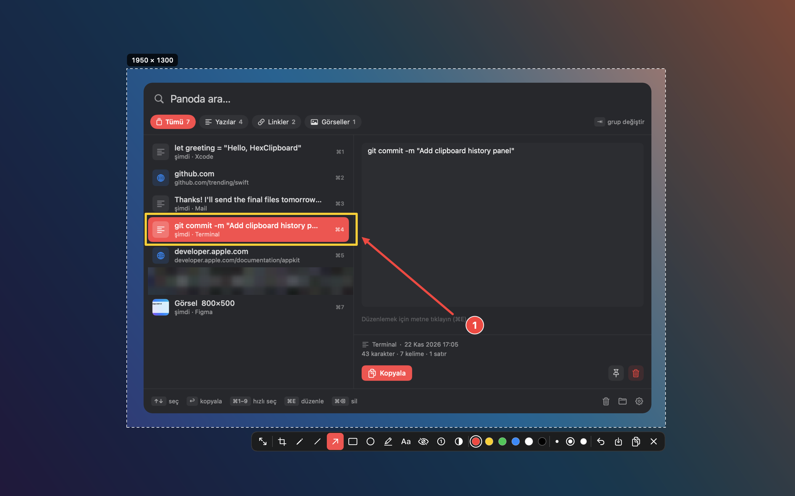

# HexShot

A local **screenshot and annotation** tool for macOS that never sends anything to the internet. Select an area, draw on it, then copy it to the clipboard or save it.



## Features
- Region and full-screen capture (shortcuts assignable in Settings)
- Tools: pen, line, arrow, rectangle, ellipse, highlighter, text, blur (pixelate), numbered steps
- Single-key tool switching (`V P L A R E M T B` …), colors, stroke sizes, undo
- Copy with `⌘C` / `Enter` / double-click, save with `⌘S`
- Lives in the menu bar, optional launch at login

## Download
**[⬇ Download HexShot.dmg](https://github.com/Huseyinkayaw/HexShot/raw/main/release/HexShot.dmg)** — open it and drag **HexShot** into **Applications**.

Requires macOS 14+ on Apple Silicon (M1 or later). The app is not notarized by Apple, so the first time you open it macOS will warn you: right-click the app → **Open** → **Open**, or go to **System Settings → Privacy & Security → Open Anyway**.

## Build from source
Requirements: macOS 14+, Apple Silicon, Xcode Command Line Tools.

```bash
./build.sh               # build and install to /Applications
./build.sh --no-install  # build only (build/)
```
Requires **Screen Recording** permission on first use.

---

## Türkçe

macOS için yerel, internete hiçbir şey göndermeyen **ekran görüntüsü ve işaretleme** aracı. Alan seçin, üzerine çizin, panoya kopyalayın ya da kaydedin.

**Özellikler**
- Alan seçme ve tam ekran yakalama (kısayollar ayarlardan atanır)
- Araçlar: kalem, çizgi, ok, dikdörtgen, elips, fosforlu kalem, metin, bulanıklaştırma (pikselleştirme), numaralı adım
- Tek tuşla araç seçimi (`V P L A R E M T B` …), renkler, kalınlıklar, geri alma
- `⌘C` / `Enter` / çift tık ile panoya kopyala, `⌘S` ile kaydet
- Menü çubuğunda çalışır, girişte başlatılabilir

**İndir:** **[⬇ HexShot.dmg](https://github.com/Huseyinkayaw/HexShot/raw/main/release/HexShot.dmg)** — açın ve **HexShot**'i **Uygulamalar** klasörüne sürükleyin. macOS 14+ ve Apple Silicon (M1 veya üstü) gerekir. Uygulama Apple tarafından onaylanmadığı (notarize edilmediği) için ilk açılışta uyarı çıkar: uygulamaya sağ tıklayın → **Aç** → **Aç**, ya da **Sistem Ayarları → Gizlilik ve Güvenlik → Yine de Aç**.

**Kaynaktan derleme:** macOS 14+, Apple Silicon ve Xcode Command Line Tools gerekir. `./build.sh` derler ve `/Applications`'a kurar; `--no-install` yalnızca derler. İlk kullanımda **Ekran Kaydı** izni gerekir.
